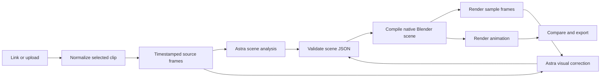

# BlendRemake architecture

## Product contract

Input is a reference clip. Output is independently generated, editable 3D geometry and animation in a `.blend`, plus rendered video. The original reference must never be substituted for a failed reconstruction. Comparison playback always exposes the actual reconstruction difference.

The app follows the familiar import → rebuild → compare → export workflow. Its identity, data, port, environment, compiler, and Git history are separate from MotionClone.

## Data flow

The correction loop runs at most once. A Blender build failure allows one repair attempt. Model analysis has a 15-minute step timeout; Blender previews have ten minutes and animation one hour. Rendering time depends strongly on geometry, resolution, frames, samples, and hardware. Animation progress reports saved frames. It does not predict completion time.

## Scene representation

`Plan` contains global materials and consecutive shots. Each shot owns an object hierarchy, camera/target animation, lights, a background, and a local timeline. A shot collection in Blender remains editable. Camera markers switch views at cuts; visibility keyframes separate shot contents. Object and camera keyframes use local seconds in JSON and convert to 24 fps absolute Blender frames. Source output is normalized to the same frame rate.

Geometry is modeled declaratively. Primitives support efficient common forms; custom indexed meshes preserve distinctive silhouettes; tube curves represent ropes, pipes, paths, and organic approximations. Object parents support joints and moving groups. Transform animation does not substitute for skeletal deformation.

The renderer is repository-owned code. The model never controls executable paths, Python source, file destinations, or shell arguments. Schema validation catches missing material references, invalid faces, parent cycles, uncovered clip time, and out-of-range keyframes before Blender launches.

## Local jobs

Each project is a randomly named directory containing an atomically replaced `job.json`, source clip, normalized reference, model receipts, validated plan, Blender outputs, and exports. A single worker avoids competing Blender renders. On shutdown, cancellation signals owned step processes; on startup, unfinished jobs become interrupted. Retry reuses a validated plan and renders again. Revision uses the existing plan plus the new direction.

The UI polls job state while a project runs. Reloading the browser does not cancel work. File routes expose only artifacts explicitly present in the job's artifact map. Source uploads, logs, and response files are not general public file routes.

## Why this first version is bounded

An unrestricted Python generator can express more Blender operations, but it also executes model output on the user's computer. A stable compiler and validated scene contract give us a reproducible first pipeline and an explicit list of supported features. Improving quality means expanding those capabilities alongside visual tests.

## Implemented in 0.2

Trusted asset recipes expand compact anatomical specifications into native meshes and curves before Blender compilation. `plan.json` stores the editable recipes; `expanded_plan.json` stores the complete portable geometry. Native shape keys animate tissue swelling. Procedural shaders provide skin pores, wood grain, subsurface color and glossy surfaces. Asset scenes use Eevee. Clips may span up to 60 seconds. The full user-supplied splinter reference is an authored visual benchmark; see [observations](SPLINTER-BENCHMARK.md).

## Remaining quality milestones

1. **Measure automatic reconstruction on real references.** The curated splinter benchmark now exists. Compare fresh Astra-generated plans against it and additional unrelated footage. Keep authored asset quality separate from model reconstruction performance.
2. **Asset-assisted reconstruction.** Allow explicitly supplied GLB/FBX assets, inspect available rig/bone names, and map observed subjects to editable assets. Preserve licensing and provenance. This is not implemented in 0.2.
3. **Character motion and deformation.** Add constrained skeleton schemas, imported animation clips, inverse kinematics targets, and rig controls. Native shape keys are implemented; evaluate against real character movement.
4. **Richer surfaces and anatomy.** Improve the implemented anatomy assets and add trusted image texture ingestion. Evaluate tissue layers, material boundaries, and shape changes.
5. **Longer videos.** Reconstruct shots independently with shared assets, shot-level cache and retry, and explicit continuity constraints. Keep the output playable and editable as one Blender project.

The remaining milestones are not features claimed by the current implementation.
